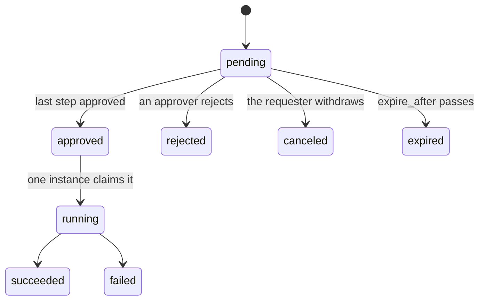

# Approvals

dbgateway never runs a write on its own judgment. A write that the policies mark `approve` becomes an **approval request**; it runs only after the people named by an **approval rule** approve it, and then dbgateway executes it once, exactly as approved.

Approval is asynchronous. `execute_sql` does not wait: it returns `status: "pending"` with the request ID, the people who can approve, the expiry and a link to the approval page. Agents follow up with `get_request` ([mcp.md](mcp.md)).

## When a write needs approval

A write is submitted for approval when all of the following hold. Otherwise it is denied, with a reason and a hint.

- `approvals.enabled: true`. When approvals are disabled (the default), every write is denied.
- The caller has `querier` and `writer` on the database. An agent also needs the `db:write` scope on its token ([authentication.md](authentication.md)).
- The database has a `write_user`. Approved writes run as this user; reads never do.
- The statement passes the parse stage, and the first matching policy rule has `action: approve` ([policies.md](policies.md)).
- It is a real write (`INSERT`, `UPDATE`, `DELETE`, `MERGE`, or a `WITH` query containing one). `TRUNCATE` is never run, because its affected rows cannot be checked. DDL never runs through dbgateway: apply schema changes through your migration process.
- The built-in guards pass. For example, an agent may not use a `masked` column in the `WHERE` of an `UPDATE`.
- An approval rule matches.

## Risk levels

Each write gets a risk level, `low`, `medium` or `high`, which approval rules can use. The same `UPDATE` can fix one row or a million, and those should not need the same approvers.

```yaml
risk:              # high first, then medium; no match = low
  high:
    - stmt.is_write && estimate.rows > 1000
    - stmt.is_write && columns.exists(c, c.class != "public")
    - stmt.is_write && principal.kind == "agent" && database.labels.env == "prod"
  medium:
    - stmt.is_write
```

- The conditions are CEL expressions with the same variables as policy rules ([policies.md](policies.md#cel-variables)), except `risk` itself. Typical inputs are the `EXPLAIN` row estimate, the classes of the columns touched, and whether the requester is an agent.
- Every write is estimated with `EXPLAIN` when approvals are enabled. The estimate runs as the write user inside a read-only transaction, without `ANALYZE`, so nothing executes. If `EXPLAIN` fails, the write is denied.
- A condition that fails to evaluate counts as a match, so errors push the risk up, not down.
- There are no built-in conditions: without a `risk` section every request is `low`.

## Approval rules

```yaml
approval_rules:    # top to bottom, first match wins
  - name: prod-high-risk
    when: database.labels.env == "prod" && risk == "high"
    steps:
      - { role: approver, count: 1 }   # someone with approver on this database
      - { group: dba, count: 1 }       # then a DBA
    expire_after: 2h
  - name: prod-default
    when: database.labels.env == "prod"
    steps:
      - { role: approver }
    expire_after: 30m
  - name: non-prod
    when: "true"
    steps:
      - { role: approver }
    max_affected_rows: 10000
```

| Field | Meaning |
| --- | --- |
| `name` | Unique; shown to approvers and recorded with the request |
| `when` | CEL condition; may use `risk` |
| `steps` | Sequential stages. Each has exactly one of `role` (`approver` or `admin`, held on the request's database) or `group` (a dbgateway group), and `count`, the number of distinct people needed (default 1) |
| `expire_after` | Time to complete every step (default `1h`, at most `7d`) |
| `max_affected_rows` | Fixed limit on affected rows, instead of the estimate-based one |

If no rule matches, the write is denied (`builtin:no-approval-route`). If a rule's condition fails to evaluate, the write is denied instead of falling through to a later rule, which might be weaker.

### Affected-rows limit

Every request carries a limit on the rows it may change: the rule's `max_affected_rows` if set, otherwise the estimate times `approvals.default_max_affected_ratio` (default 2.0), rounded up and at least 1. Approvers see the limit, and execution enforces it.

## Lifecycle



On submission dbgateway stores the request in the management database with:

- the raw and the normalized SQL, the reason, the requester, the database;
- the analysis summary, the estimate, the risk and the affected-rows limit;
- the approval rule's steps, frozen as they were at submission;
- the configuration version and a **binding hash**.

The request ID is the gateway request ID (`req_` plus 128 random bits), so the audit log entries of the query and of the approval share it. Every state change is written to the audit log (event `approval`) and published as a notification event ([notifications.md](notifications.md)).

### Who can see a request

The requester (the person and any of their agents), people eligible for one of its steps, and people who already acted on it. Everyone else gets "not found", exactly as for an ID that does not exist.

## Approving

Approving happens in the web UI only (`/approvals/{id}`), by a person:

- **No self-approval.** The requester can never approve. For an agent's request, the person the agent acts for counts as the requester.
- **One person, one step.** Nobody approves more than one step of the same request.
- The approver must hold the step's role on the database, or belong to its group, at the time of approval.
- **Step-up authentication.** Approving requires a re-authentication no older than `approvals.step_up_max_age` (default 5 minutes): a passkey, or an IdP re-login that dbgateway verifies. Without a fresh one, the approve button leads to the step-up page and back, and the approver confirms again. See [authentication.md](authentication.md).
- Agents cannot approve, reject or elevate; their tokens do not work on these pages or APIs.

After the last step, the request becomes `approved` and is executed in the background.

### What approvers see

- the requester (agent and person), the database and the expiry;
- the SQL normalized (literals replaced) and as submitted (with values, which can be hidden);
- the reason, labelled as written by the agent or by the person and shown as inert text with links and mentions disabled, so that text written by an AI cannot steer the approver;
- the tables, the columns touched with their data classes, the estimated rows and the risk;
- the approval rule, its steps and progress, and the affected-rows limit ("rolls back if more than N rows change");
- after execution, the result: rows affected, `RETURNING` rows masked as they would be for the requester, or the error.

Lists and notifications show only the normalized SQL.

## Rejecting and canceling

- **Reject:** any person eligible for any step (except the requester), with an optional comment. No step-up is needed, so it also works from the Slack button. Available in the web UI, in Slack, and as `dbgw request reject <id> --comment ...` ([cli.md](cli.md)).
- **Cancel:** the requester (or one of their agents) withdraws a pending request, in the web UI (`/requests`) or with `dbgw request cancel <id>`.

Only approving needs the web UI, because it needs a fresh step-up in the browser session.

## Execution

Exactly one worker executes an approved request, even with several dbgateway instances sharing a PostgreSQL management database ([ha.md](ha.md)). The request moves from `approved` to `running` by a conditional update, which also makes the approval single-use. Then:

1. **Binding hash.** The hash over (database, raw SQL, requester, approval rule, configuration version) is checked. If anything changed after submission, the request fails. A different SQL is always a new request.
2. **Audit first.** A `running` entry is written to the audit log. If it cannot be written, the write does not run.
3. **Re-evaluation.** The requester's role (`writer`) and the policies are evaluated again with the current configuration. Groups come from the requester's last login (or SCIM) and the current configuration. If the decision is no longer `approve` under the same approval rule, the request fails ("the decision has changed"). An agent's request still runs if its token has expired, as long as the person it acts for still holds `writer`.
4. **Write.** The statement runs as the write user in a read-write transaction with the database's `statement_timeout` and `lock_timeout`. If it affects more rows than the limit, it is **rolled back** and the request fails.
5. **Result.** `RETURNING` rows are masked like read results for the requester and stored with the request. The outcome is audited and `execution_finished` is published.

A request found `running` for longer than any execution could take (dbgateway stopped mid-write) is marked `failed` with an unknown outcome. It is never run again; check the database. Approved requests that were not started (for example, because of a restart) are picked up by the background loop.

## Time-limited roles (JIT)

Grant someone a role for a limited time with a personal role binding that expires:

```yaml
role_bindings:
  - user: bob@example.com
    databases: [prod-main]
    roles: [querier]
    expires_at: 2026-12-01T00:00:00Z
```

The binding stops applying at `expires_at`; nothing has to be revoked. The user screens (`/users`) can generate the YAML for such a change as a proposal to paste into a pull request. Permissions change only through the configuration.

## Unmask

Unmask lets specific people see `masked` columns as they are. It is separate from roles, can be time-limited, and **never applies to agents**:

```yaml
unmask:
  - user: alice@example.com      # or group:
    databases: [prod-main]
    expires_at: 2026-11-30T00:00:00Z
```

It affects query results, exports, `RETURNING` rows of their own writes, and the `masked` marks in schema search. `no_ai` columns are visible to people anyway. See [masking-and-audit.md](masking-and-audit.md).

## Break-glass elevation

For incidents when no approver is reachable, a person with the `approver` role can elevate themselves to run writes without approval for a limited time.

```yaml
break_glass:
  max_duration: 1h                       # default 1h, at most 24h
  databases: { labels: { env: prod } }   # where elevation is possible
```

- **Who:** a person (never an agent) holding `approver` on every database they elevate for, each selected by `break_glass.databases`. Requires `approvals.enabled`.
- **How:** on the web page `/breakglass`, with a reason and a fresh step-up authentication, for at most `max_duration`.
- **Effect:** while the elevation is active, that person's writes that would need approval run immediately, from the SQL editor or the CLI. Parse-stage rejections, policy denials, the built-in guards and the affected-rows limit still apply. The elevation is re-checked against the current configuration on every write.
- **Audit and notification:** granting the elevation writes a `break_glass` audit entry and publishes `break_glass_used`, typically routed to a security channel ([notifications.md](notifications.md)). Each elevated write is audited before it runs and again with its result, both marked `break_glass: true`, so incidents can be reviewed in full afterwards.

A sealed emergency path that bypasses dbgateway entirely is an operational procedure; see [operations.md](operations.md).
