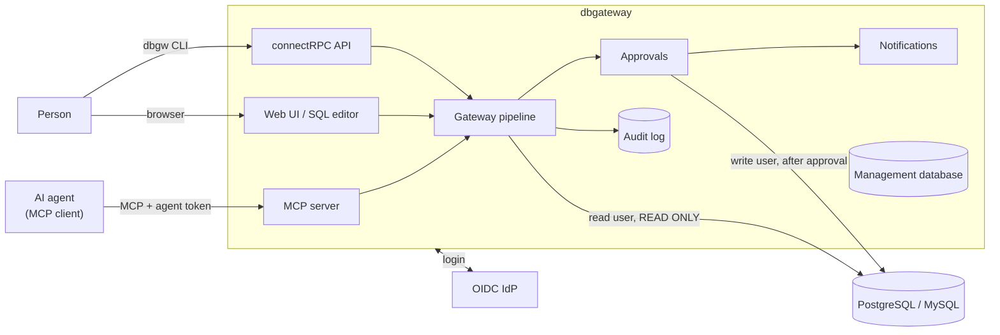

# Architecture

dbgateway is a single process (`dbgw serve`) that sits between people, AI agents and production databases. Every statement goes through the same pipeline, whichever way it arrives: the SQL is parsed with the database's own parser, checked against roles and policies, executed with tight limits, masked, and written to the audit log. Reads that pass run immediately; writes wait for a human approval; everything else is denied with a reason.

## Components

| Component | Code | Role |
| --- | --- | --- |
| MCP server | `internal/mcp` | Tools for AI agents over Streamable HTTP at `/mcp` (stateless). See [MCP](./mcp) |
| connectRPC API | `proto/dbgateway/v1`, `internal/api` | `GatewayService` (queries, approval requests) and `TokenService` (agent tokens) for the CLI. Human tokens only |
| Web UI | `internal/web` | SQL editor (`/console`), approvals, requests, audit log search, users, break-glass elevation. See [SQL editor](./console) |
| CLI | `cmd/dbgw`, `internal/cli` | `dbgw query`, `dbgw login`, `dbgw mcp stdio`, `dbgw token`, plus admin commands (`config validate`, `policy test`, `audit verify`). See [CLI](./cli) |
| Authorization server | `internal/auth` | OIDC and passkey login, OAuth for agents, device flow for the CLI, step-up authentication. See [Authentication](./authentication) |
| Gateway pipeline | `internal/gateway` | The one place every request is decided. All entry points call it |
| DB adapters | `internal/adapter/postgres`, `internal/adapter/mysql` | Parsing (pg_query / TiDB parser), catalog, planner estimates, execution. They translate each dialect into a database-independent analysis (`internal/analysis`) |
| Policy engine | `internal/policy` | Roles, CEL policies, risk levels, approval rules. See [Policies](./policies) |
| Masking | `internal/mask` | Data classes, masking methods, value-based PII detection. See [Masking and audit](./masking-and-audit) |
| Approvals | `internal/approval` | Approval requests, multi-step approval, execution of approved writes, break-glass elevation. See [Approvals](./approvals) |
| Audit log | `internal/audit` | Hash-chained JSON Lines (files or PostgreSQL), optional OTLP forwarding |
| Management database | `internal/store` | Users, sessions, tokens (hashed), passkeys, approval requests, SQL editor history. SQLite or PostgreSQL |
| Notifications | `internal/notify` | Slack (Socket Mode, outbound only) and signed webhooks. See [Notifications](./notifications) |

Adding a database means implementing `analysis.Adapter`; policies, approvals, masking and audit do not know which database they are working with.

## Request pipeline

What happens to one statement sent through `execute_sql`, the SQL editor or `dbgw query`:

1. **Authenticate.** The bearer token or browser session is resolved to a principal: a human, or an agent acting for a human. Groups and roles are recomputed from the current configuration on every request, so revocations and role changes apply immediately.
2. **Role check.** The caller needs `querier` on the database. An unknown database and a missing role produce the same answer, so callers cannot probe which databases exist. A non-empty `reason` is required.
3. **SQL analysis.** The adapter parses the SQL. Anything unparsable, more than one statement, transaction control, session settings and other side-effecting statements are rejected here, as are functions outside the allowlist (see [Security](./security#rejected-statements)). The statement is classified (`select`, `insert`, `update`, `delete`, `merge`, `truncate`, `ddl`); a data-modifying CTE makes it a write.
4. **Column lineage.** Names are resolved against the database catalog with a fixed search path. Every referenced column is recorded with where it is used (output, filter, group, order, write), through `*`, aliases, expressions, subqueries, CTEs and views. If something cannot be resolved, the statement is marked unknown.
5. **Data classes.** Each column gets a class: `public`, `masked` or `no_ai`. Unclassified columns default to `public`, except for agents on databases labelled `env: prod`, where they default to `masked`.
6. **CEL policy.** For writes, the caller must also hold `writer` and the database must have a write user. A planner estimate (`EXPLAIN`) is taken when needed: always for writes, and for reads only if a policy uses `estimate`. Policies are evaluated top to bottom and the first match decides: allow, approve or deny. No match means deny. A rule whose condition fails to evaluate counts as a match if it denies and is skipped otherwise.
7. **Built-in guards.** These apply regardless of configuration (also in shadow mode): only a plain `SELECT` can be allowed; a statement with unknown parts is never executed; agents may not use non-public columns in `WHERE`, `JOIN`, `GROUP BY` or `ORDER BY`; writes require approvals to be enabled and can never be allowed without approval; `TRUNCATE` is never executed. See [Policies](./policies#built-in-guards).
8. **Execution.** Before running, the masking plan is computed from the lineage; if any output column cannot be traced, nothing is returned. The statement runs as the read-only database user, in a `READ ONLY` transaction with `statement_timeout`, `lock_timeout`, row and byte limits, and the session is reset afterwards (`DISCARD ALL` on PostgreSQL; the connection is discarded on MySQL). A policy can route the read to a replica.
9. **Masking.** Masked columns are redacted, partially shown or replaced by a keyed hash; `no_ai` columns are withheld from agents. People with an unmask grant see masked values. For agents, values in columns that would be shown can also be scanned for personal data.
10. **Audit.** One line is written for every request, including denials. If the audit log cannot be written, the result is withheld (fail closed).

The response carries the rows, a notice that the content is data and not instructions, and, when limits were hit, `truncated` and a hint. Denials carry the stage (`parse`, `role`, `policy`), the rule, a reason and a hint on how to get through.

## Writes and approvals

When the decision is approve, the first matching approval rule decides who must approve, in how many steps, and for how long. The request is stored in the management database and the caller gets `status: pending` with a request ID; agents check back with `get_request`. Approvers are notified, open the approval page, re-authenticate (passkey or IdP) and approve. dbgateway then verifies the stored binding hash, re-evaluates role and policy, and runs the write as the write user, rolling back if it affects more rows than the approvers were shown. See [Approvals](./approvals).

## Typical flows

**Setting up.** An administrator runs dbgateway on the databases' private network, creates a read-only user and a write user on each database, connects the OIDC provider and Slack, and describes groups, roles, policies, approval rules and data classes in one YAML file reviewed through pull requests. The database firewall then only admits dbgateway.

**Connecting an agent.** A developer adds dbgateway's URL to their MCP client. On the first tool call the browser opens; they log in, name the agent, pick the databases it may use and, optionally, allow write requests. The agent calls `list_databases` to see what it can do.

**Investigating with an agent.** The agent finds tables with `search_objects` (masked columns are marked), then calls `execute_sql` with a reason. The read is allowed, runs, and comes back masked. If the result was truncated, the agent narrows the query.

**Changing data.** The agent checks with `explain_policy`, then submits the `UPDATE`. It gets a pending request and tells the developer. Approvers get a Slack message (literals removed), open the approval page, review the full statement and approve with a passkey. dbgateway runs it and posts the outcome to the same thread; the agent reads the result with `get_request`.

**Querying as a person.** Analysts and support staff use the SQL editor or `dbgw query`. They go through the same pipeline as agents and are recorded as themselves. No SSH, bastion host or shared database password is needed.

**Being denied.** The agent gets the reason and a hint (for example, "no WHERE clause; narrow the target rows") and fixes the query. If a permission is missing, the developer asks for a role change through a pull request to the configuration.

**Emergencies.** An on-call person with the `approver` role can take a time-limited break-glass elevation (reason and step-up required). Their writes then run without approval; parse-stage and policy denials still apply. The elevation is announced to the security channel and every action is marked in the audit log. Agents cannot use it.

**Reviewing access.** Auditors search the audit log by person, agent, database or table, compare each `reason` with the SQL, and verify the hash chain with `dbgw audit verify`.

**Schema changes** are not run through dbgateway. DDL is denied; migrations go through pull requests and the team's existing deployment tooling.

## Deployment

dbgateway is one binary and one YAML file. Run it next to the databases, behind HTTPS, and not exposed to the internet.

- **Single instance.** SQLite management database and audit log files. Suits a VM and a small team.
- **Multiple instances.** Management database and audit log in PostgreSQL (`store.driver: postgres`, `audit.output: postgres`). Instances share tokens, sessions and approval requests; the MCP endpoint is stateless, so any instance can serve any call. An approved write is executed by exactly one instance (a conditional state change), and audit writes are serialized so there is a single hash chain. See [High availability](./ha).
- **Container platforms.** ECS Fargate and Cloud Run both work, with IAM database authentication. On Cloud Run, keep CPU always allocated and at least one instance, because approved writes and expirations run outside requests. See [Deploying](./deploy) and the Terraform examples in [deploy/aws-ecs](../deploy/aws-ecs/) and [deploy/gcp-cloudrun](../deploy/gcp-cloudrun/).

Because dbgateway becomes the only way in, run it redundantly and keep a sealed, normally disabled emergency path to the database (see [Operations](./operations)).
