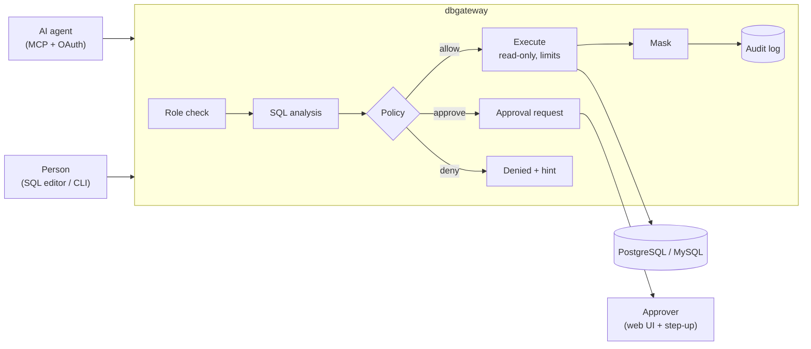

# What is dbgateway?

dbgateway is a gateway that sits between your production databases and everyone who queries them — AI agents and people. It understands the SQL it receives: each statement is parsed, checked against roles and policies, then **allowed, sent for human approval, or denied**. Results are masked according to the data classification, and every request is written to a tamper-evident audit log.

It runs as a single binary and supports PostgreSQL and MySQL.

## Why

Giving an AI agent a database connection string means trusting every statement it will ever generate — including ones produced by a prompt injection hidden in the data it reads. Keyword filters and read-only users help, but they cannot tell which columns a query exposes, whether a write is bounded, or who asked for it.

dbgateway puts a reviewer in that path that reads SQL the way the database does:

- **It knows what a statement does.** Statement kind, tables and columns read or written, functions called, whether an `UPDATE` has a `WHERE` clause — taken from the real parse tree, not from patterns.
- **It knows who is asking.** Agents act on behalf of a signed-in person and never get more rights than that person.
- **It knows what the data is.** Columns are classified as `public`, `masked` or `no_ai`, and masking follows each output column back to its source.

## How it works

1. An agent calls `execute_sql` over MCP (or a person runs SQL in the [SQL editor](./console) or the [CLI](./cli)) with a **reason**.
2. dbgateway parses the statement and refuses anything it cannot fully analyze, such as multiple statements, transaction control or unknown functions.
3. [Policies](./policies) decide: reads that match an `allow` rule run at once in a read-only transaction with row, size and time limits; writes become [approval requests](./approvals); everything else is denied with a hint.
4. Results are [masked](./masking-and-audit) by data class and returned with a notice that they are data, not instructions.
5. Each step is recorded in the [audit log](./masking-and-audit#audit-log).

## Features

| Area | What you get |
| --- | --- |
| Agents | MCP tools `list_databases`, `search_objects`, `execute_sql`, `get_request`, `explain_policy`; OAuth 2.1 with consent; short-lived agent tokens |
| People | Web SQL editor with completion, history, saved queries and audited export; CLI (`dbgw query`); approval, request and audit screens in English and Japanese |
| Policy | Five roles, groups (static, OIDC or SCIM), CEL rules, shadow mode, `dbgw policy test` |
| Approvals | Risk levels, multi-step approval rules, passkey or IdP step-up, affected-row limits, time-limited roles, break-glass elevation |
| Data protection | Column masking by lineage, `no_ai` columns, value-based PII detection |
| Operations | Slack and webhook notifications, OpenTelemetry export, IAM database authentication on AWS and Google Cloud, multi-instance mode with PostgreSQL |

## What dbgateway is not

- **Not a schema migration tool.** DDL is refused; schema changes belong in migrations reviewed in Git.
- **Not a database administration UI or a client proxy.** People run SQL in the web SQL editor or the CLI; there is no wire-protocol endpoint for desktop clients, so results cannot be saved outside dbgateway's control.
- **Not a replacement for database permissions.** Keep least-privilege database users; they remain the last line of defense. See the [security model](./security).

## Status

dbgateway is early software. The configuration format, APIs and MCP tool shapes may change before 1.0. Please report security issues privately as described in [SECURITY.md](../SECURITY.md).

Next: try it locally with the [Quickstart](./quickstart).
